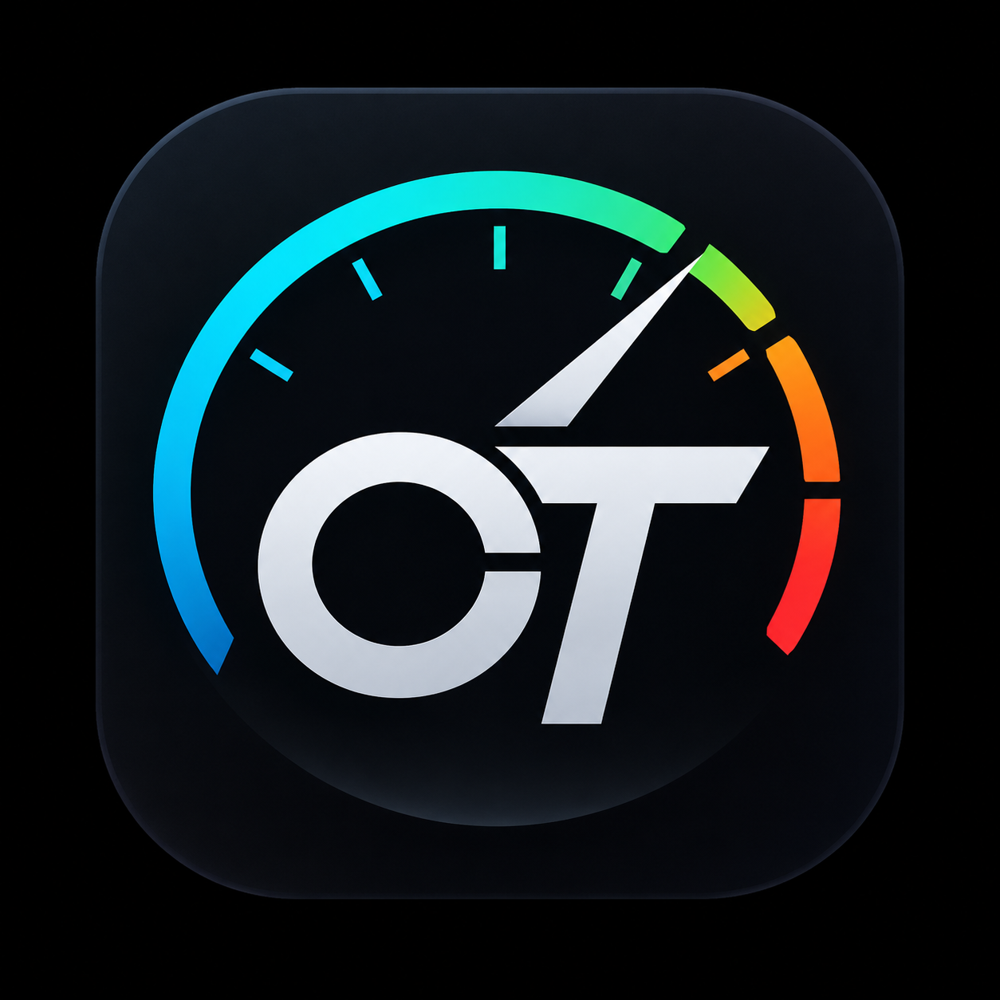

# OpenTripper 🏍️

<p align="center">
  
  <br>
  <strong>Open technology for motorcycle instrumentation.</strong>
  <br>
  <em>Aplicativo open source de instrumentação automotiva, telemetria e navegação para motocicletas, desenvolvido inicialmente para a Royal Enfield Hunter 350 e seu Tripper Pod.</em>
</p>

<p align="center">
  <a href="https://github.com/OSolerHugo/opentripper/releases/latest"></a>
  <a href="LICENSE"></a>
  <a href="#"></a>
  <a href="PROTOCOLO.md"></a>
</p>

---

## ⚡ Download Rápido

Baixe a versão mais recente diretamente para o seu smartphone Android. Este link é permanente e aponta sempre para o build mais novo com chave de assinatura definitiva (as atualizações subsequentes instalam por cima sem conflito):

<p align="center">
  <a href="https://github.com/OSolerHugo/opentripper/releases/latest/download/opentripper.apk">
    
  </a>
</p>

> [!NOTE]
> **Instalação e Google Play Protect:** Como o OpenTripper é distribuído diretamente via GitHub (fora da Google Play Store), o Google Play Protect pode exibir uma mensagem informando desenvolvedor não reconhecido. Basta clicar em **"Mais detalhes"** ➔ **"Instalar assim mesmo"**. O projeto é 100% auditável e open source.

---

## 🧭 O que é o OpenTripper?

O painel secundário **Tripper Pod** que equipa a **Royal Enfield Hunter 350** (e outras motos da plataforma J-Series como Meteor e Classic) opera através de um módulo BLE da NXP (`RE_DISP`). O aplicativo proprietário oficial possui restrições de navegação, limitações de rota e consumo excessivo de bateria.

O **OpenTripper** foi desenvolvido a partir de engenharia reversa completa do protocolo para fornecer:
1. **Liberdade total de navegação:** Uso do Google Maps e Waze reais na tela do Tripper Pod.
2. **Instrumentação automotiva no celular:** Velocímetro digital GPS de alta precisão, odômetro, bússola e telemetria.
3. **Estabilidade de conexão:** Motor BLE *Dual-Role GATT Server* nativo que elimina as quedas de 5 segundos causadas pelos watchdogs proprietários do firmware.
4. **Respeito à bateria:** Desligamento imediato do hardware GPS do celular assim que a moto é desligada.

---

## ✨ Principais Funcionalidades

### 🔄 Modo Híbrido (Google Maps & Waze Turn-by-Turn)
* **Captura em Segundo Plano:** Lê as notificações oficiais do Google Maps e Waze via Notification Listener Service e converte manobras instantaneamente em pacotes binários do Tripper.
* **Catálogo Amplo de Manobras:** Conversões à esquerda/direita (90°, suaves, fechadas), saídas de rodovia, bifurcações, retornos (U-Turn) e reta.
* **Suporte Completo a Rotatórias:** Mapeamento verificado em bancada e na moto da 1ª à 9ª saída (`0x0B` a `0x13`).
* **Distância e ETA:** Exibição precisa em metros ou quilômetros no visor secundário do Pod.

### 🏎️ Instrumentação & Design Industrial
Interface mobile-first projetada sob a diretriz de instrumentação automotiva técnica, robustez industrial e acabamento profissional escuro:
* **Tema Dark Técnico:** Superfícies em grafite (`#0A0E17`, `#141C28`), texto de alto contraste (`#E8EDF3`), destaques em Cyan (`#00C2D9`), Verde (`#22C785`), Âmbar (`#F5A623`) e Vermelho (`#E05252`).
* **Navegação em 4 Áreas:**
  * **1. Dashboard:** Conexão Bluetooth, status de pareamento, velocidade em tempo real, resumo de sessão e espelho virtual do display do Tripper.
  * **2. Navegação:** Monitor de rota ativa com banner estilizado do app de navegação (Maps/Waze), instrução da próxima manobra e distância restante.
  * **3. Cruzeiro:** Painel de cruzeiro com velocímetro digital em destaque, indicador de rumo/bússola, odômetro parcial da viagem e tempo de deslocamento.
  * **4. Dispositivo:** Conexão BLE, auto-reconexão, banner dinâmico para validação do PIN de pareamento, botão **"Esquecer Dispositivo"**, explorador de ícones (Fuzzer) e console de telemetria.

### 🛡️ Motor BLE com Dual-Role GATT Server
* O firmware da NXP no Tripper Pod exige que o celular não atue apenas como cliente, mas também instancie um servidor local GATT com o serviço `01FF0100-BA5E-F4EE-5CA1-EB1E5E4B1CE0`.
* O OpenTripper executa ambos simultaneamente, com serialização estrita de pacotes de 20 bytes com checksum `CRC-16/CCITT-FALSE` e keepalive contínuo (1,5s) para evitar o watchdog de timeout do painel.

### 🔍 Fuzzer & Diagnóstico de Ícones Integrado
* Ferramenta de exploração integrada no app permitindo injetar sequencialmente os 256 códigos (`0x00` a `0xFF`) para inspecionar ícones ocultos do firmware diretamente no visor da motocicleta, gravando anotações no arquivo local `opentripper_logs.txt`.

---

## 📱 Instalação e Configuração

### Pré-requisitos
* Smartphone com **Android 8.0 (Oreo / API 26)** ou superior.
* Royal Enfield Hunter 350 com Tripper Pod funcional (ou outra Royal Enfield com módulo NXP BLE `RE_DISP`).

### Passo a Passo

1. **Baixar o APK:** Baixe [opentripper.apk](https://github.com/OSolerHugo/opentripper/releases/latest/download/opentripper.apk).
2. **Permissões Essenciais:**
   * **Bluetooth & Localização:** Necessárias para encontrar o dispositivo BLE e calcular a telemetria GPS.
   * **Acesso a Notificações:** Vá em *Configurações ➔ Notificações ➔ Acesso a Notificações* e autorize o **OpenTripper** para permitir a leitura do Google Maps e Waze.
3. **Primeira Conexão na Moto:**
   * Ligue a chave de ignição da moto (a janela de anúncio BLE do Tripper Pod fica aberta por ~30 segundos).
   * Abra a aba **Dispositivo** e clique em **CONECTAR TRIPPER**.
   * Quando o Tripper Pod exibir o código de 6 dígitos no mostrador, o OpenTripper exibirá automaticamente o cartão de validação. Digite o código e confirme.
   * Pronto! O dispositivo fica memorizado para conexões automáticas subsequentes.

---

## 🔬 Documentação Técnica do Protocolo

Para engenheiros, entusiastas e desenvolvedores que desejam entender ou expandir a comunicação com o hardware:

* 📄 **[PROTOCOLO.md](PROTOCOLO.md):** Especificação completa com UUIDs, formato do pacote de 20 bytes, algoritmo CRC-16, watchdogs de firmware, pacotes fixos e catálogo detalhado de ícones hexadecimais.
* 📄 **[Especificações de Design & Arquitetura](docs/superpowers/):** Documentação arquitetural do pipeline de notificações e modo híbrido.

---

## 🛠️ Compilação e Desenvolvimento

O OpenTripper é construído em Java nativo com Android SDK padrão:

```bash
# Clone o repositório
git clone https://github.com/OSolerHugo/opentripper.git
cd opentripper

# Compilar build de debug
./gradlew assembleDebug

# Compilar APK assinado de release
./gradlew assembleRelease
```

O APK gerado ficará localizado em `app/build/outputs/apk/release/app-release.apk`.

---

## 🤝 Contribuição

Contribuições são muito bem-vindas!
* Encontrou um ícone ou código novo no Tripper? Envie um Pull Request atualizando o `PROTOCOLO.md` ou abra uma *Issue*.
* Ideias de novas telas de telemetria ou integração com outros sensores Bluetooth (TPMS, velocímetro OBD2) são encorajadas.

---

## 📄 Licença

Distribuído sob a licença **MIT**. Consulte o arquivo [LICENSE](LICENSE) para mais detalhes.

*Aviso: Este é um projeto independente da comunidade open source e não possui vínculo formal com a Royal Enfield ou a NXP Semiconductors.*
