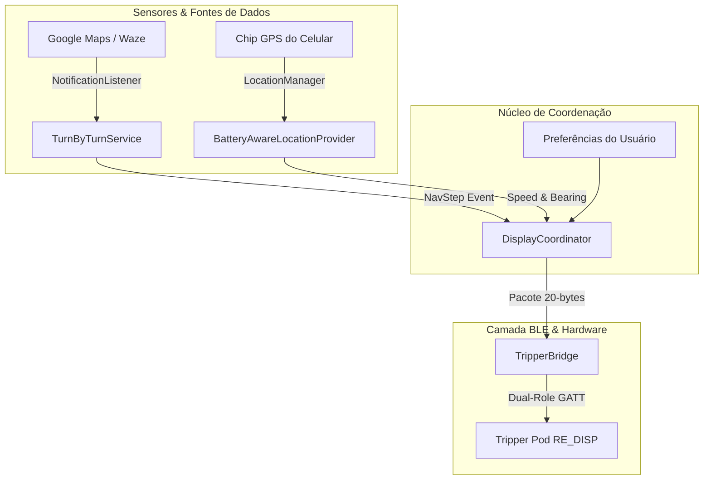

# Especificação de Design: OpenTripper Modo Híbrido (Navegação & Velocímetro)

* **Data:** 2026-11-07
* **Status:** Aprovado
* **Plataforma:** Android Nativo (SDK 26+ / Android 8.0+)
* **Alvo de Hardware:** Royal Enfield Hunter 350 - Tripper Pod (NXP BLE `RE_DISP`)

---

## 1. Visão Geral e Objetivos

O **OpenTripper** evolui de uma ferramenta de engenharia reversa e diagnóstico para um **aplicativo completo de instrumentação para motociclistas**. O objetivo principal é fornecer uma experiência "ligou a moto e andou" (*zero friction*), sem exigir interação manual contínua com a tela do smartphone.

### Capacidades Centrais:
1. **Modo Híbrido Inteligente:**
   * **Modo Navegação (Prioridade 1):** Quando houver uma rota ativa no Google Maps ou Waze, extrai instruções curva-a-curva, distâncias e horários de chegada (ETA), projetando-os no display.
   * **Modo Cruzeiro (Prioridade 2):** Quando não houver rota ativa, o visor vira um **Velocímetro Digital de alta precisão** baseado em GPS (padrão) ou **Bússola Digital 360°**.
2. **Gestão Agressiva de Bateria (Zero-Drain):**
   * Nenhum consumo de GPS ou processamento contínuo enquanto a moto estiver desligada.
   * Varredura BLE em hardware puro (`SCAN_MODE_LOW_POWER`) somente se o usuário ativar o auto-conectar.
3. **Persistência e Confiabilidade:**
   * Reconexão automática ao ligar a ignição.
   * Sincronização automática do relógio do painel.
   * Tolerância e keepalive anti-queda de watchdog (1,5s).

---

## 2. Arquitetura de Módulos (Separação de Responsabilidades)

### Componentes:
* `TripperBridge`: Gerencia o ciclo de vida BLE, GATT Server local, atraso de 300ms pós-conexão, filas seriais e watchdog de keepalive.
* `BatteryAwareLocationProvider`: Provedor de GPS sob demanda. Inicia escuta apenas quando `TripperBridge` reporta conexão estabelecida; encerra escuta no milissegundo em que a conexão cai.
* `TurnByTurnService`: `NotificationListenerService` oficial do Android que monitora notificações ativas de `com.google.android.apps.maps` e `com.waze`, decodificando ações de direção, distâncias e rotatórias.
* `DisplayCoordinator`: Orquestrador de estados. Determina quem tem o direito de desenhar na tela (Navegação > Cruzeiro) e monta o pacote `0x10 0x11` final com CRC-16.
* `MainActivity`: Interface limpa para o piloto com espelho do visor, interruptores de controle e acesso à aba secundária de diagnóstico.

---

## 3. Gestão de Energia e Ciclo de Vida (Battery-Preserving Strategy)

| Estado da Moto | Chip GPS | Rádio BLE | CPU do Celular |
|---|---|---|---|
| **Moto Desligada (Auto-conectar OFF)** | Desligado | Desligado | Dormindo (0% uso) |
| **Moto Desligada (Auto-conectar ON)** | Desligado | Varredura de hardware filtrada (`RE_DISP`) | Dormindo (acorda só no match BLE) |
| **Moto Ligada (Conectada)** | Ativo (apenas se em movimento) | Conectado (Watchdog 1,5s) | Ativo em segundo plano leve |

---

## 4. Decodificação de Navegação (Google Maps & Waze)

### 4.1 Captura de Notificações
O `TurnByTurnService` intercepta as notificações permanentes de navegação:
* **Google Maps (`com.google.android.apps.maps`):**
  * Extração do ícone vetorial da ação da notificação (`Notification.EXTRA_LARGE_ICON` ou `Notification.EXTRA_SMALL_ICON`).
  * Regex de texto de distância (`EXTRA_TITLE` ou `EXTRA_TEXT`): captura valores em metros (`m`) e quilômetros (`km`).
  * Detecção de rotatórias: identifica termos como "rotatória", "saída" ou números de saída (1ª a 9ª) mapeando diretamente para `0x0B..0x13`.
* **Waze (`com.waze`):**
  * Extração similar de textos de manobra e distâncias.

### 4.2 Mapeamento de Ícones
* Seguir em frente: `0x09`
* Virar esquerda / direita: `0x14` / `0x15`
* Curva acentuada esquerda / direita: `0x16` / `0x17`
* Curva suave esquerda / direita: `0x18` / `0x19`
* Rotatórias (1ª a 9ª saída): `0x0B` a `0x13`
* Retorno: `0x3D`
* Destino / Chegada: `0x01`

---

## 5. Modo Cruzeiro (Velocímetro & Bússola)

Quando não há rota no Maps/Waze, o `DisplayCoordinator` gera pacotes de instrumento:

### 5.1 Velocímetro Digital (Standard)
* **Byte `[2]` (Ícone):** `0x09` (Seta de direção para frente) ou seta orientada pelo rumo.
* **Byte `[3..4]` (Valor):** Velocidade calculada (`location.getSpeed() * 3.6f`), truncada ou arredondada.
* **Byte `[5]` (Unidade):** `0x01` (para exibir formato limpo de número inteiro).
* **Byte `[11..13]` (Linha inferior):** Hodômetro parcial da viagem (km acumulados na sessão).

### 5.2 Bússola Digital 360° (Opcional via Toggle)
* **Byte `[2]`:** `0x41` (Comando nativo de ativação da rosa dos ventos do Tripper).
* **Byte `[14]`:** Ângulo de rumo magnético em graus (`0` a `359` mapeado em byte).

---

## 6. Interface do Usuário (UI/UX)

1. **Tela Principal (Dashboard do Piloto):**
   * Indicador visual de conexão (status em tempo real).
   * **Espelho do Visor:** Componente visual que reproduz no celular o que a moto está exibindo.
   * Interruptor `Auto-conectar ao ligar a moto` (salvo em `SharedPreferences`).
   * Seletor de Modo Cruzeiro: `Velocímetro` vs `Bússola`.
   * Card de status da permissão de notificação do Android (com atalho para habilitar se necessário).
2. **Aba Secundária (Ferramentas de Engenharia / Diagnóstico):**
   * Explorador / Fuzzer de ícones (`0x00..0xFF`).
   * Console de logs em disco com botões de cópia, envio e limpeza.

---

## 7. Critérios de Aceite e Verificação

1. **Eficiência Energética:** O app não deve manter wakelocks ou listeners de GPS ativos com a moto desconectada.
2. **Estabilidade de Conexão:** Ao ligar a ignição, a conexão deve ser restabelecida sem travamentos do stack NXP.
3. **Transição Híbrida:** Alternar entre rota ativa no Waze e cruzeiro no velocímetro em menos de 1 segundo, sem necessidade de tocar no celular.
4. **Resistência a Quedas:** O loop de keepalive deve continuar ativo em primeiro plano (Foreground Service com notificação persistente discreta).
